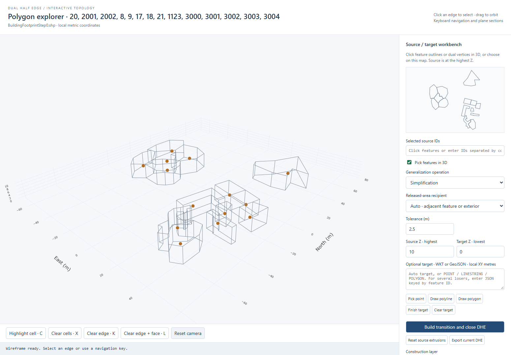
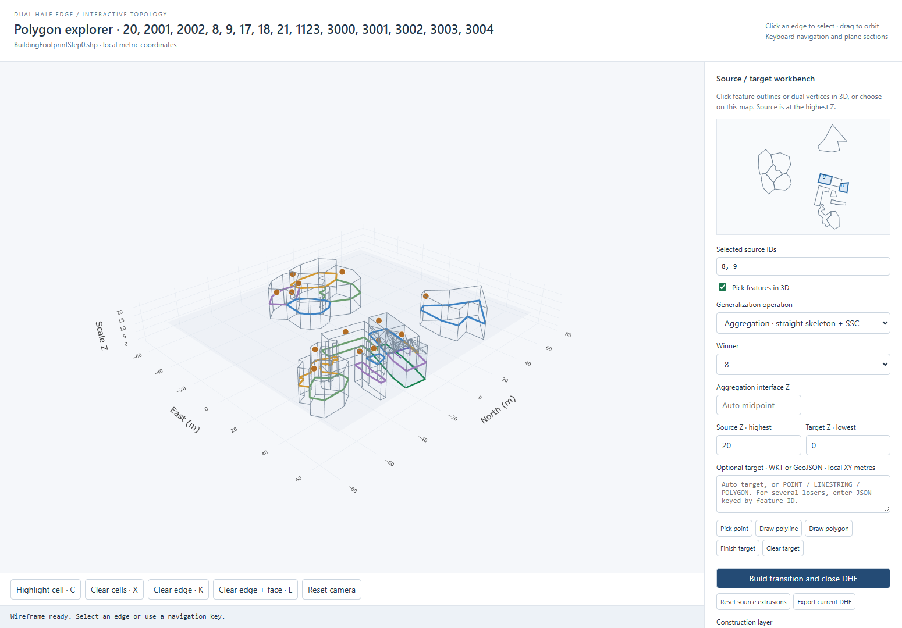
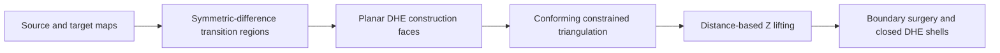

# DHE Space-Scale Generalization

**Interactive 3D GIS research software for topology-aware map generalization.**

[](https://github.com/ashkeyakh/dhe-space-scale/actions/workflows/tests.yml)

Developed by **Amin Gholami**. This project represents building footprints as
linked primal and dual half-edges, and encodes their generalization in a 3D
space-scale model: **source geometry at the highest Z, target at the lowest Z**.
Horizontal slices recover intermediate 2D maps.



## What it demonstrates

- Dual Half Edge topology with real `V`, `S`, `NV`, `NF`, and `D` links.
- Polygonal source caps, including holes, with triangulated transition surfaces.
- One source/target pipeline shared by simplification, merging, collapse, and aggregation.
- Coupled neighbour updates through shared owner-labelled interfaces.
- Arbitrary point, polyline, and polygon targets, with drawing and WKT/GeoJSON input.
- Two-stage aggregation: outward straight-skeleton partitions, then an SSC merge.
- Interactive 3D selection, half-edge navigation, dual graphs, and horizontal,
  vertical, or inclined slicing.
- Closed-shell validation, signed-volume checks, and independent section oracles.

This is a **research prototype**, with explicit geometric limitations documented
in [the implementation guide](TRANSITION_WORKBENCH.md).

## Quick start — no external data required

Requires **Python 3.12**. Install the dependencies into a virtual environment.

Windows / PowerShell:

```powershell
git clone https://github.com/ashkeyakh/dhe-space-scale.git
cd dhe-space-scale
py -3.12 -m venv .venv
.venv/Scripts/python.exe -m pip install -r requirements.txt
.venv/Scripts/python.exe run_demo.py
```

Linux / macOS:

```bash
git clone https://github.com/ashkeyakh/dhe-space-scale.git
cd dhe-space-scale
python3.12 -m venv .venv
.venv/bin/python -m pip install -r requirements.txt
.venv/bin/python run_demo.py
```

The browser opens a local workbench with **14 synthetic footprints**. The public
demo is generated from `demo_data.py`; the screenshots show the research dataset,
which is not distributed. No GitHub account, API key, or internet connection is
needed to run the viewer after installing dependencies.

In **PyCharm**, select the project's virtual environment, open `run_demo.py`, and
right-click **Run**. Keep Python running while using the browser. If an embedded
preview does not connect, open the loopback URL printed in the Run console in
Edge, Chrome, or Firefox. Stop the server with Ctrl+C or PyCharm's Stop button.

## Try an operation

1. Select feature IDs by clicking their outlines/dual vertices in 3D, using the
   small map, or entering IDs in the selection field.
2. Choose an operation and its winner or released-area recipient.
3. Use the automatic target, draw a target, or enter WKT/GeoJSON in local XY metres.
4. Click **Build transition and close DHE**.
5. Enable the slicing plane and move Z to inspect intermediate maps. Construction
   layers expose the transition regions, triangulation, lifting, and skeleton.

| Example | Selection | Result |
| --- | --- | --- |
| Simplification | 2001 | Simplified polygon and coupled neighbour update |
| Merge | 2001, 2002 | Chosen winner takes the union; loser ends as point/line/boundary |
| Collapse to point or polyline | 2001 | Interior automatic or user-defined target |
| Aggregation | 8, 9 | Skeleton partition at an interface Z, then union under the winner |
| Custom target | One feature | Transition to a supplied valid polygon target |

All finite dual vertices are visible initially; faces start unfilled. Navigation
highlights only the current face/cell with transparent colours. Green dual links
are shown only where the DHE records an actual connection.



## Common geometric construction



Points and polylines are inserted explicitly as constraints because they have
zero area. Source/target boundary intersections are noded globally. Wedges above
and below the lifted field carry their map owners, so incident cells use the same
transition interface. Internal faces are removed and coplanar patches are joined.
Original cap faces remain polygons. This is a batch constructor with boundary
surgery; numeric half-edge IDs are regenerated after a build.

Aggregation first computes true straight-skeleton wavefront faces with
`py_straight_skeleton`, partitions the requested target, and smoothly expands the
sources to those partitions. A separate classic SSC event merges them at the
interface. The default target is the convex hull of the selected union.

## Use your own shapefile

Copy `workbench.local.example.json` to `workbench.local.json` and set `input_shp`
to your local shapefile path, or set the `DHE_INPUT_SHP` environment variable.
Then run:

```bash
python run_workbench.py
```

Edit `ID_FIELD`, `FEATURE_IDS`, and scale levels in `workbench_config.py`.
Keep `.shp`, `.shx`, `.dbf`, and `.prj` sidecars together. Input coordinates are
projected to a local metric CRS; Z is scale, not building height. Local settings,
input datasets, generated output, credentials, and virtual environments are not
part of the public repository. With no shapefile configured, the workbench uses
the synthetic demo automatically. `--demo` always forces the synthetic input.

## Tests

Python tests use the standard library's test runner. Install **Node.js 22+** for
the JavaScript section oracle, then run:

```bash
python -m unittest discover -v
```

Private-dataset integration tests skip when their configured shapefile is absent.
The remaining geometry, topology, synthetic demo, and independent slicing checks
run without private data. GitHub Actions runs this suite on each push and PR.

The live browser test additionally requires Playwright:

```bash
npm install --no-save playwright
npx playwright install chromium
node test_workbench.cjs
```

Set `PLAYWRIGHT_BROWSER_CHANNEL=msedge` to use installed Edge, or set `PYTHON` if
your interpreter is not the project's `.venv` or `python` on PATH. Earlier browser
examples also have tests; those require their generated demonstration files.

## Code and documentation

| File | Responsibility |
| --- | --- |
| `extrude.py` | Shapefile input, polygonal extrusion, linked DHE model and validation |
| `target_geometry.py` | Operation-specific targets and coverage policies |
| `transition_regions.py` | Symmetric difference, shared triangulation and Z lifting |
| `transition_brep.py` | Wedge boundary sewing, KEF/KVE refinement and closure |
| `skeleton_partition.py` | Outward straight-skeleton target partitions |
| `unified_operations.py` | Common public generalization API |
| `dhe_geometry.js` | Navigation and plane/shell sections |
| `workbench_server.py` | Loopback Python backend |
| `workbench.js`, `viewer.js`, `viewer.html` | Interactive browser controls and Plotly rendering |

See [TRANSITION_WORKBENCH.md](TRANSITION_WORKBENCH.md) for the six construction
steps, coverage rules and limitations; [GENERALIZATION_DESIGN.md](GENERALIZATION_DESIGN.md)
for earlier SSC examples; and [docs/LEGACY_EXPLORER.md](docs/LEGACY_EXPLORER.md)
for the original extrusion explorer.

## Reference and attribution

The navigation convention follows Boguslawski & Gold (2016),
[The Dual Half-Edge](https://doi.org/10.3390/ijgi5020019). The straight-skeleton
implementation uses [py_straight_skeleton](https://github.com/iconbuild/py_straight_skeleton)
and constrained triangulation uses [Triangle](https://rufat.be/triangle/).
See [NOTICE.md](NOTICE.md) for data attribution and licensing status.
Repository citation metadata is provided in `CITATION.cff`.
